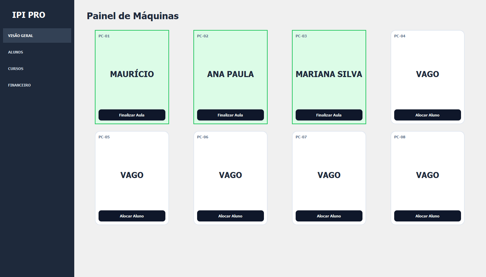

# IPI PRO: gestão de sala de informática

[](https://github.com/MauricioApCastro/Ipi_Manager/actions/workflows/ci.yml)


Sistema desktop para **escolas de informática**: mostra em tempo real quais máquinas estão ocupadas e por quem, e reúne alunos, turmas, cursos, frequência e financeiro num só lugar.

Um projeto [MAC Tecnology](https://mactecnology.com.br).



## Funcionalidades

- **Painel da sala:** cada máquina é um card que muda de cor (vaga / ocupada). Clique para alocar um aluno, que já fica marcado como presente.
- **Trava de duplicidade:** o mesmo aluno não pode ocupar duas máquinas ao mesmo tempo.
- **Seleção inteligente:** abas separam os alunos das turmas de hoje das exceções e reposições.
- **Alunos, turmas e cursos:** cadastro, matrícula e módulos por curso.
- **Frequência:** calendário de presença e agendamento de reposições.
- **Financeiro e caixa:** registro de pagamentos, pendências e exportação em CSV.
- **Documentos em PDF:** recibos de pagamento e diplomas, com atalho para enviar pelo WhatsApp.
- **Backup:** cópia automática diária e backup manual.

## Requisitos

- Python 3.10 ou superior (para desenvolver)
- Windows para o executável final; o código também roda em Linux e macOS

## Como executar

```bash
git clone https://github.com/MauricioApCastro/Ipi_Manager.git
cd Ipi_Manager

python -m venv .venv
# Windows: .venv\Scripts\activate   |   Linux/macOS: source .venv/bin/activate

pip install -r requirements.txt
python main.py
```

Para popular o sistema com dados de exemplo: `python scripts/seed_demo_data.py`.
Para zerar o banco: `python scripts/reset_database.py`.

## Testes

```bash
pip install -r requirements-dev.txt
pytest -q
```

Os testes cobrem os principais fluxos (cadastro, turmas, financeiro, recibos) usando um banco temporário.

## Gerar o executável e o pacote do cliente (Windows)

```bash
pip install -r requirements-build.txt
pyinstaller --onefile --windowed --name IPI_Manager main.py
```

Monte o pacote com `dist/IPI_Manager.exe`, `INSTALAR_CLIENTE.bat`, [`INSTALACAO_CLIENTE.md`](INSTALACAO_CLIENTE.md) e [`MANUAL_PROFESSORA.md`](MANUAL_PROFESSORA.md). Para distribuir, anexe o `.zip` a uma **Release** do GitHub.

## Estrutura

```
├── main.py                 # ponto de entrada
├── src/
│   ├── database/           # conexão SQLite, schema e repositórios (CRUD)
│   ├── models/             # Aluno, Máquina
│   ├── services/           # configurações, recibos e diplomas em PDF
│   └── ui/
│       ├── windows/        # telas (painel, alunos, turmas, financeiro...)
│       └── components/     # card de máquina, seletor de aluno
├── scripts/                # dados de demonstração e reset do banco
├── tests/                  # testes de fluxo do sistema
├── INSTALACAO_CLIENTE.md   # guia de instalação para a escola
└── MANUAL_PROFESSORA.md    # manual de uso do dia a dia
```

Na primeira execução, o sistema cria as pastas `data/` (banco), `recibos/` e `backups/`. Elas ficam fora do Git porque contêm dados dos alunos.

## Desenvolvimento

```bash
ruff check .          # análise de código
ruff format .         # formatação automática
```

O GitHub Actions roda lint, verificação de sintaxe e testes a cada envio para a branch `main`.

## Autor

**Maurício Castro** · [MAC Tecnology](https://mactecnology.com.br) · contato@mactecnology.com.br
